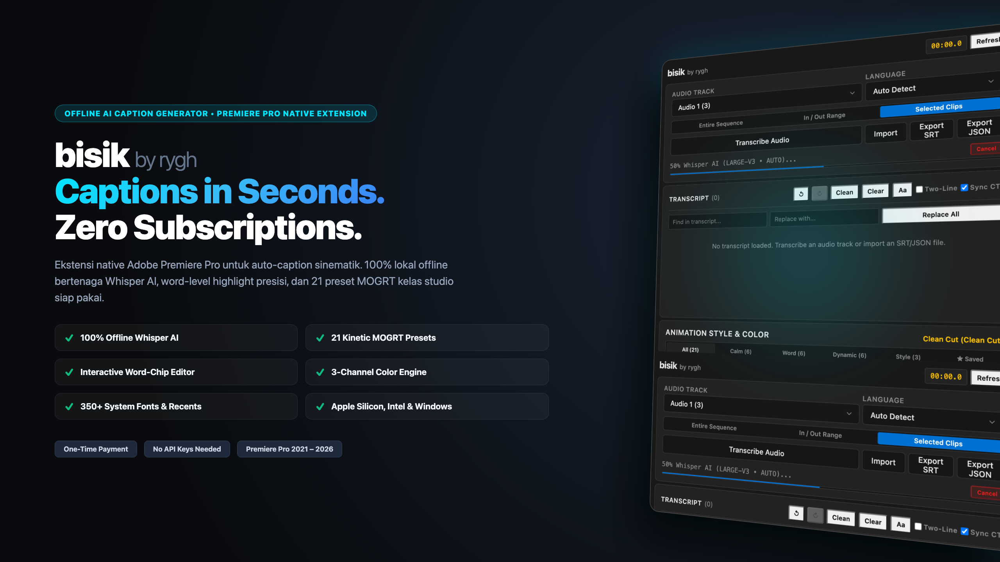
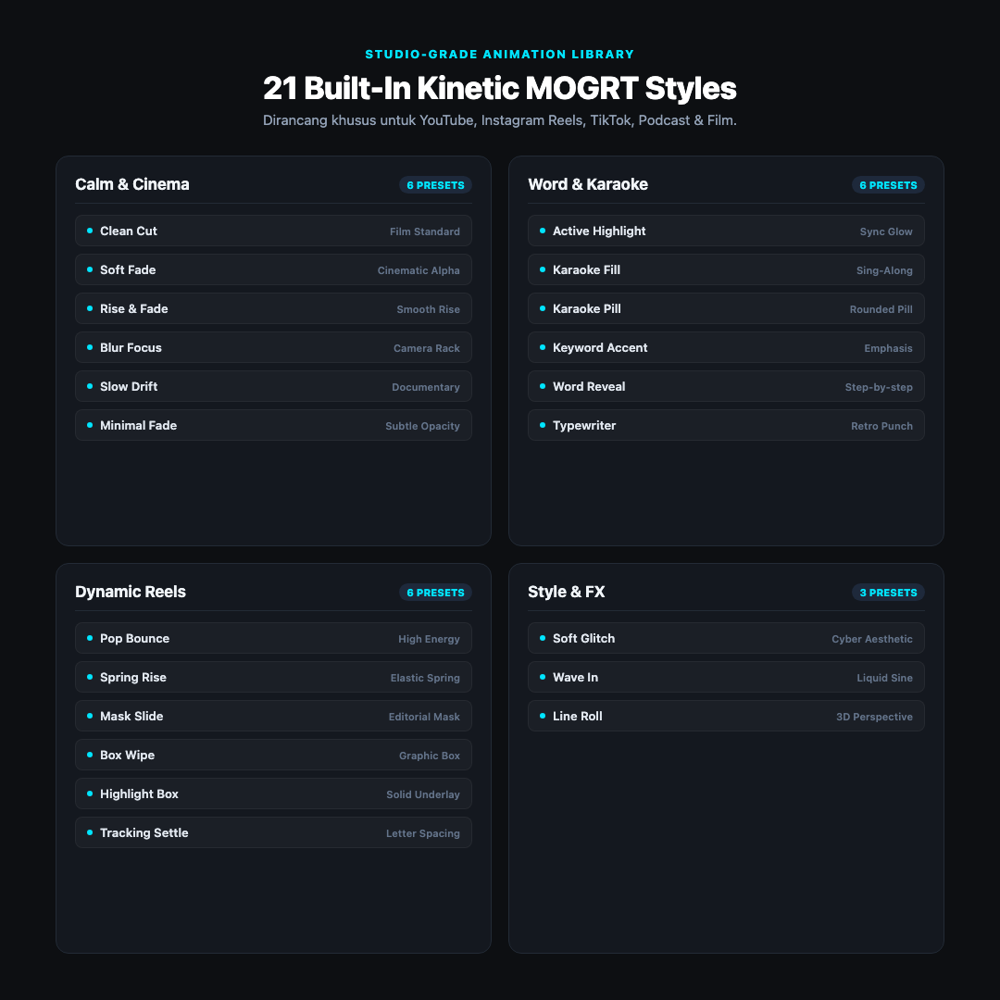
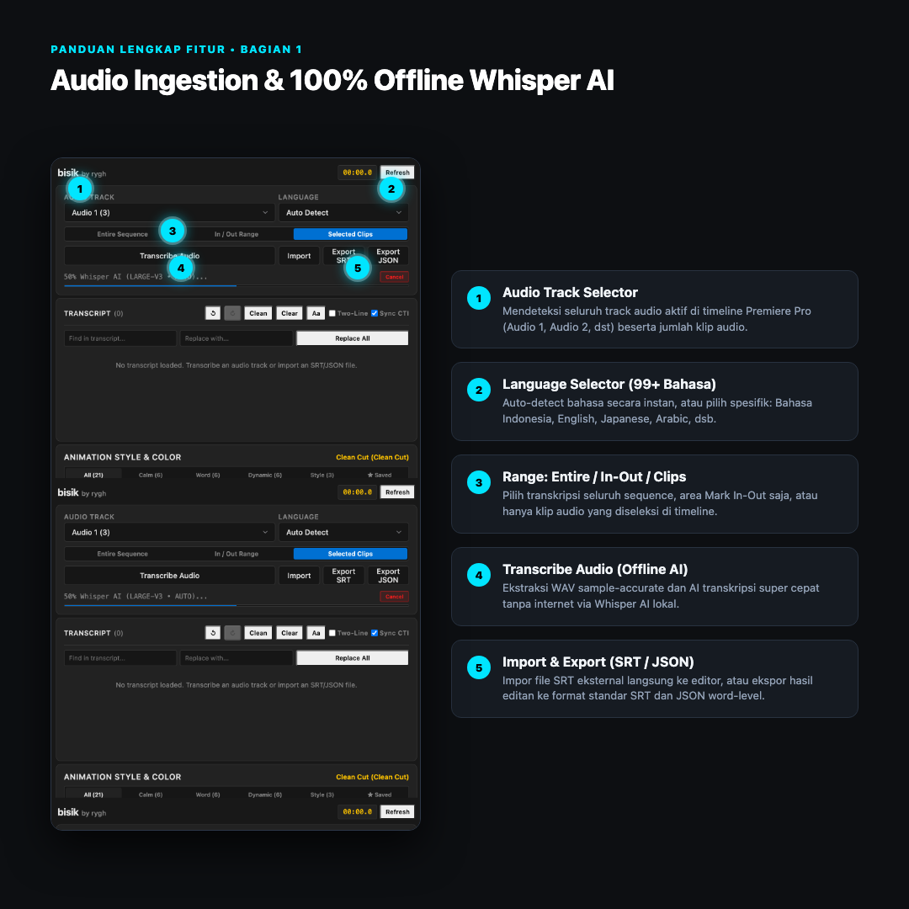
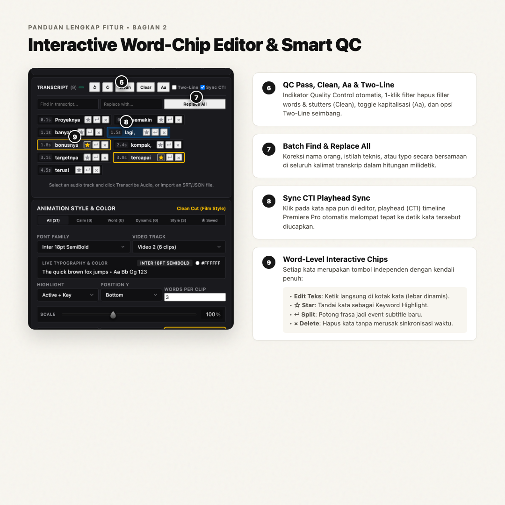

# bisik by rygh



> **100% Offline, Privacy-First AI Captions & Kinetic Typography for Adobe Premiere Pro.**  
> Powered by local Whisper AI (`whisper.cpp`) and native Motion Graphics Templates (`.mogrt`). Zero API keys, zero cloud uploads, zero subscriptions.

---

[](https://github.com/rygh30/bisik-by-rygh)
[](https://helpx.adobe.com/premiere-pro/user-guide.html)
[](https://github.com/ggerganov/whisper.cpp)
[](https://ffmpeg.org/)
[](#21-kinetic-mogrt-caption-styles)
[-success?style=flat-square)](#developer--test-suite)
[](docs/EULA.md)

---

## Key Features

- **100% Local and Privacy-Guaranteed**: Audio extraction (FFmpeg) and speech transcription (Whisper.cpp) run entirely on your local CPU, Apple Neural Engine, or GPU. Zero audio files or transcripts ever touch the internet.
- **Zero Subscriptions and Zero API Keys**: No monthly token quotas, no OpenAI billing meters, and no cloud queues. Transcribe unlimited hours offline for a one-time purchase.
- **21 Kinetic MOGRT Caption Styles**: Handcrafted `.mogrt` templates organized into 4 curated categories (*Calm & Cinema*, *Word & Karaoke*, *Dynamic Reels*, and *Style & FX*). Includes real-time proportional text scaling (20%–200%).
- **Interactive Word-Chip Editor**: Every spoken word is an interactive chip. Correct typos directly in-place, star key terms for persistent highlight (`[Star]`), manually split phrases into new caption events (`[↵]`), or delete filler words (`[×]`) without breaking timeline synchronization.
- **3-Channel Color & Particle Engine**: Customize primary font color, active/keyword highlight color, and decorative particle/box background colors independently using the integrated Photoshop-style RGB Color Picker and 8 Spectrum Quick Palette swatches.
- **350+ System Fonts & 5 Recent Fonts**: Automatically scans and indexes all local fonts installed on your Mac or Windows system with instant search, plus quick access to your 5 most recently used fonts.
- **Smart QC & One-Click Audio Cleaning**: Automatic Quality Control warnings for fast reading speed (>20 CPS) or excessive line length (>38 CPL). Features one-click filler word removal (`Clean`), title/upper/lower case toggling (`Aa`), and character-balanced two-line splitting (`Two-Line`).
- **Sample-Accurate Timecode Alignment**: Quantizes subframe speech boundaries to exact Adobe universal tick frames (254,016,000,000 ticks/sec) for seamless playback across all sequence framerates.
- **99+ Languages Supported**: Powered by OpenAI's Whisper multilingual model (Indonesian, English, Spanish, Japanese, Korean, German, French, Portuguese, Arabic, and more) with automatic language detection.

---

## 21 Kinetic MOGRT Caption Styles

<p align="center">
  
</p>

| Category | Styles Included | Best For |
| :--- | :--- | :--- |
| **Calm & Cinema (6)** | `Clean Cut`, `Soft Fade`, `Rise & Fade`, `Blur Focus`, `Slow Drift`, `Minimal Fade` | Feature films, documentaries, cinematic vlogs, narrative video |
| **Word & Karaoke (6)** | `Active Highlight`, `Karaoke Fill`, `Karaoke Pill`, `Keyword Accent`, `Word Reveal`, `Typewriter` | TikTok, Reels, YouTube Shorts, sing-along, high-retention social |
| **Dynamic Reels (6)** | `Pop Bounce`, `Spring Rise`, `Mask Slide`, `Box Wipe`, `Highlight Box`, `Tracking Settle` | Fast-paced educational content, podcasts, high-energy edits |
| **Style & FX (3)** | `Soft Glitch`, `Wave In`, `Line Roll` | Cyber, tech reviews, creative trailers, stylistic title cards |

---

## Quick Start Guide

<p align="center">
  
  
</p>

1. **Select Source Track & Transcribe:** Choose your dialog audio track in Premiere Pro, pick your language, and click `Transcribe Audio`.
2. **Review & Style:** Make any desired word corrections in the interactive word chips editor, select your favorite MOGRT animation style, and choose your typography and color palette.
3. **Insert Captions:** Click the green `Insert Captions to Timeline` button. The extension will automatically generate and place synchronized animated captions directly onto your timeline sequence.

---

## Download & Installation

Visit the [Releases](https://github.com/rygh30/bisik-by-rygh/releases) page to download the latest pre-packaged installer bundle for your operating system:

### macOS Apple Silicon (M1/M2/M3/M4)
Download `bisik_by_rygh_macOS_v1.1.1.zip`:
1. **Double-click** `1_Install_Bisik_Extension.pkg` and complete the installer wizard.
2. **Double-click** `2_Setup_AI_Engine.command` to automatically configure Homebrew, FFmpeg, Whisper CLI, and speech models.
3. Launch Adobe Premiere Pro and open: `Window > Extensions > bisik by rygh`.

### macOS Intel (Core i5/i7/i9/Xeon — No Homebrew Required)
Download `bisik_by_rygh_macOS_Intel_v1.1.1.zip`:
1. **Double-click** `1_Install_Bisik_Extension.pkg` and complete the installer wizard.
2. **Double-click** `2_Setup_AI_Engine.command` (precompiled standalone `whisper-cli` is included; portable FFmpeg and models are configured automatically without root permissions).
3. Launch Adobe Premiere Pro and open: `Window > Extensions > bisik by rygh`.

### Windows (10 / 11 64-bit)
Download `bisik_by_rygh_Windows_v1.1.1.zip`:
1. **Double-click** `1_Install_Extension.bat` to automatically install the signed `.zxp` extension and configure CEP debug mode.
   *(Alternative: drag-and-drop `bisik_by_rygh.zxp` into [ZXP Installer](https://zxpinstaller.com/)).*
2. **Double-click** `2_Setup_AI_Engine.bat` to automatically download and configure FFmpeg, Whisper CLI, and your selected AI speech model.
3. Launch Adobe Premiere Pro and open: `Window > Extensions > bisik by rygh`.

> [!NOTE]  
> **Updating from a Previous Version:** If FFmpeg and Whisper AI are already installed on your machine, simply run Step 1 (`1_Install_Bisik_Extension.pkg` or `1_Install_Extension.bat`) while Premiere Pro is closed. Your existing AI engine and downloaded models will be detected automatically.

---

## Whisper AI Models Supported

During setup, you can select which Whisper AI speech model to download:

| Model | Download Size | Memory Required | Recommended Use Case |
| :--- | :---: | :---: | :--- |
| **Tiny** | `~75 MB` | `~1 GB RAM` | Ultra-fast drafting, basic speech recognition |
| **Base** | `~145 MB` | `~1 GB RAM` | Fast, everyday podcasts and casual vlogs *(Default)* |
| **Small** | `~460 MB` | `~2 GB RAM` | Balanced speed with elevated accuracy |
| **Medium** | `~1.5 GB` | `~5 GB RAM` | High precision for mixed accents & multilingual audio |
| **Large-v3** | `~3.1 GB` | `~6 GB RAM` | Maximum precision, ideal punctuation & complex audio |

---

## Developer & Test Suite

The project includes an extensive automated test suite covering audio processing, timecode conversion, sub-frame quantization, DOM integrity, MOGRT schema validation, and Whisper engine compatibility:

```bash
# Clone the repository
git clone https://github.com/rygh30/bisik-by-rygh.git
cd bisik-by-rygh

# Run full automated test suite (97 tests, 27 suites — 100% pass)
npm test

# Build macOS Apple Silicon Distribution ZIP bundle (.pkg + .command)
npm run package-mac-zip

# Build macOS Intel Standalone Distribution ZIP bundle (.pkg + portable binary)
npm run package-mac-intel-zip

# Build Windows Distribution ZIP bundle (.zxp + .bat)
npm run package-win-zip
```

---

## License

Distributed under the [bisik by rygh End User License Agreement (EULA)](docs/EULA.md).  
You retain 100% full commercial ownership of all video outputs, subtitles, and captions generated with this extension.

Copyright (c) 2026 rygh. All rights reserved.
