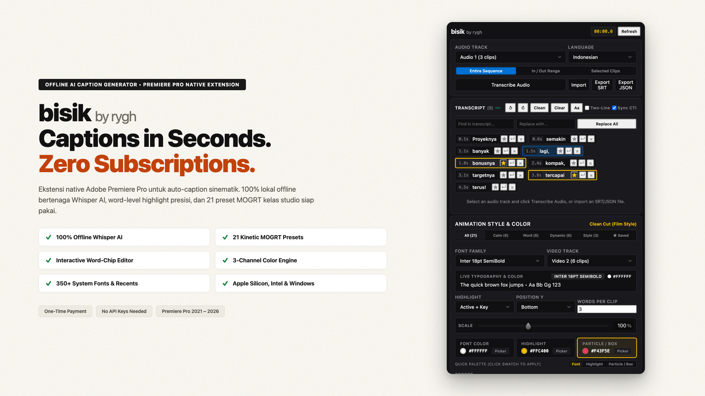
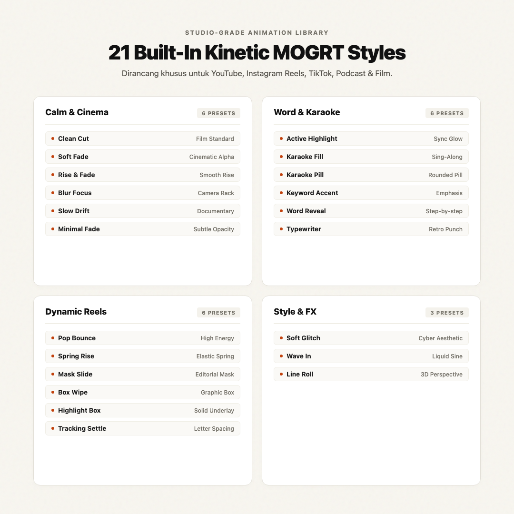
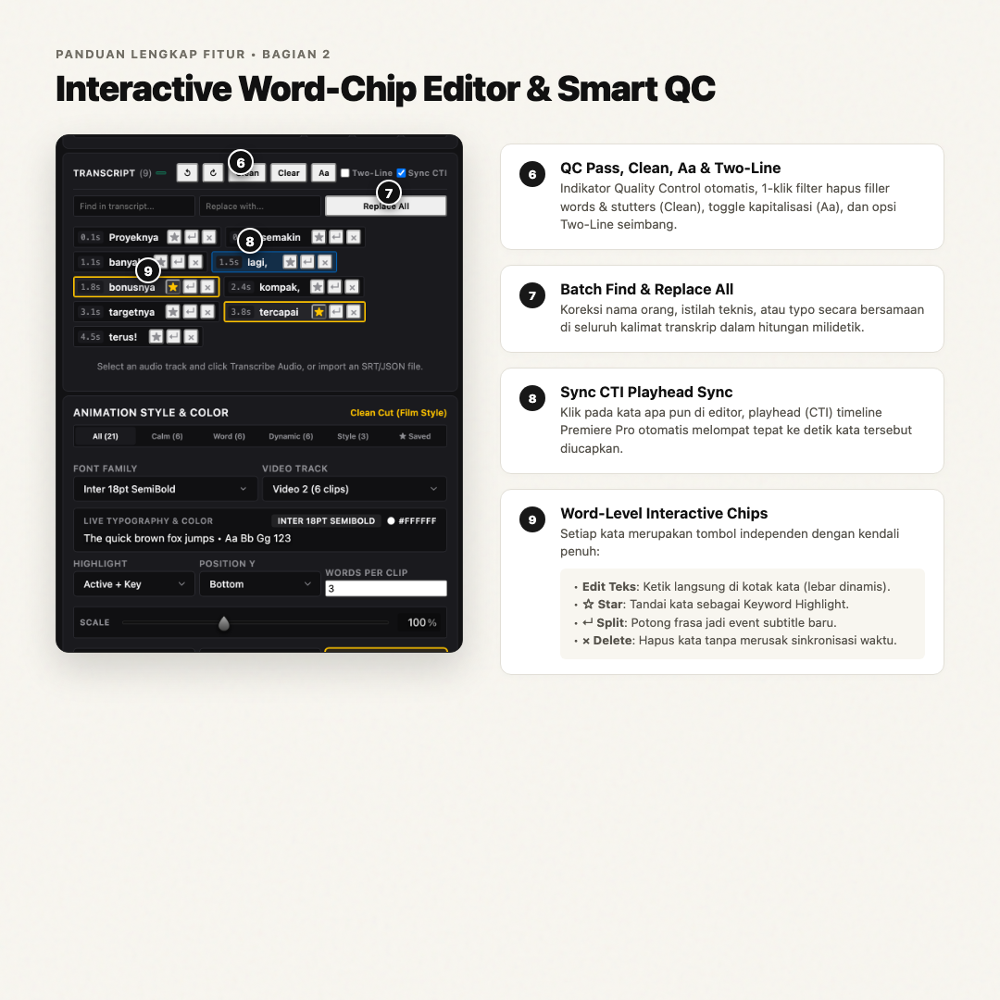
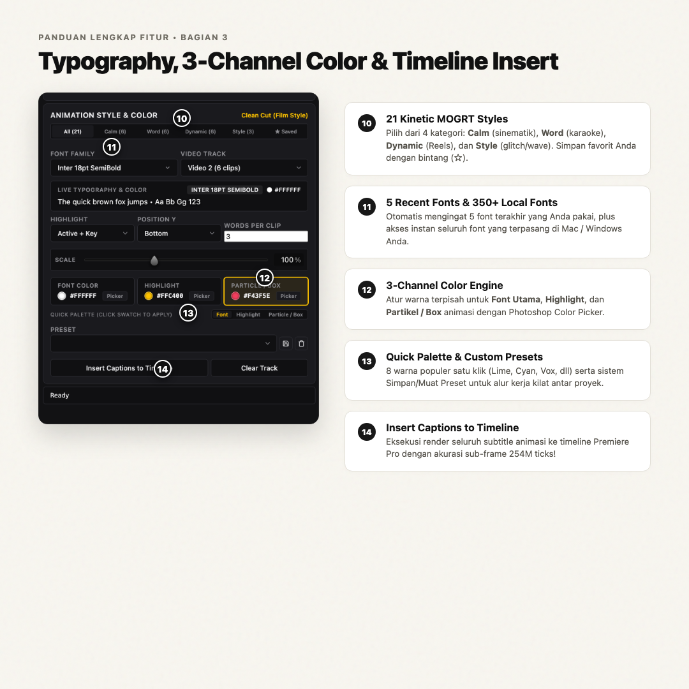
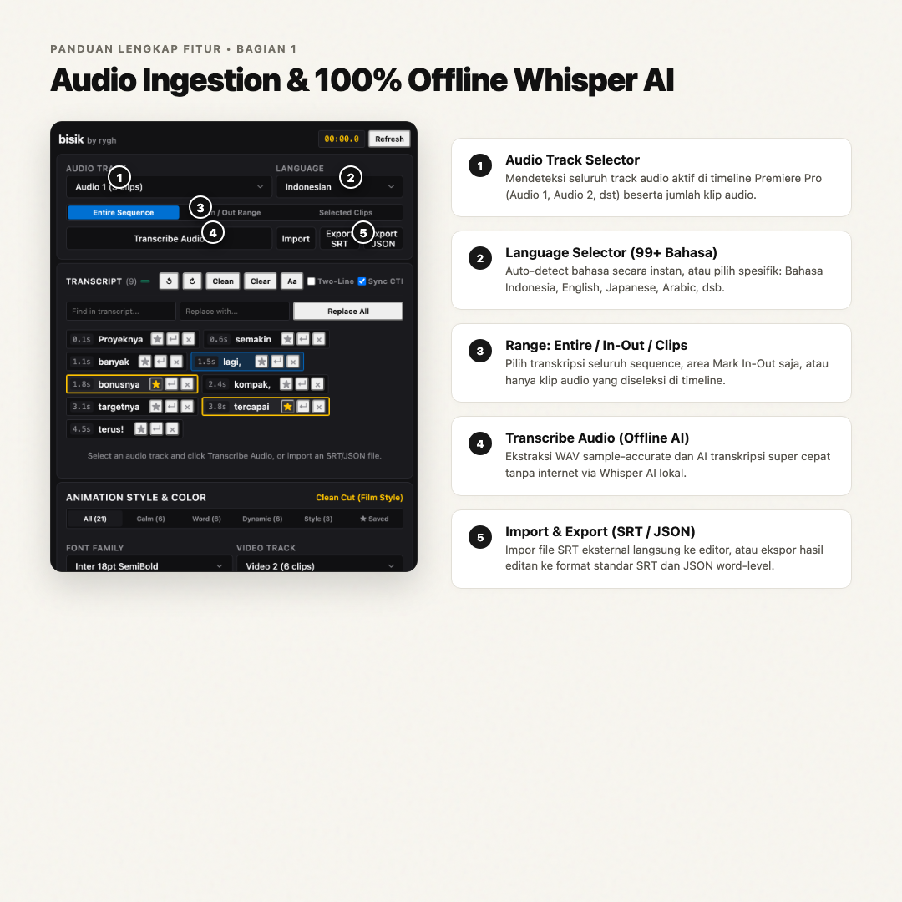

# bisik by rygh v1.1.1

  

## Overview

**bisik by rygh v1.1.1** introduces 21 studio-grade kinetic MOGRT animation styles, an interactive word-chip transcript editor, a 3-channel color engine, automatic system font scanning with recent font persistence, and offline Whisper AI capability probing.

This release provides pre-packaged installer bundles for **macOS Apple Silicon (ARM64)**, **macOS Intel (x86_64 Standalone)**, and **Windows 10/11 (64-bit)**.

---

## What's New in v1.1.1

### 1. 21 Kinetic MOGRT Caption Styles
Handcrafted Motion Graphics templates organized into 4 curated categories, complete with real-time text scaling (20% to 200%):
- **Calm & Cinema (6):** `Clean Cut`, `Soft Fade`, `Rise & Fade`, `Blur Focus`, `Slow Drift`, `Minimal Fade`
- **Word & Karaoke (6):** `Active Highlight`, `Karaoke Fill`, `Karaoke Pill`, `Keyword Accent`, `Word Reveal`, `Typewriter`
- **Dynamic Reels (6):** `Pop Bounce`, `Spring Rise`, `Mask Slide`, `Box Wipe`, `Highlight Box`, `Tracking Settle`
- **Style & FX (3):** `Soft Glitch`, `Wave In`, `Line Roll`

  

### 2. Interactive Word-Chip Editor
- **Direct Typo Editing:** Edit words directly inside interactive chips with automatic dynamic width adjustment.
- **Keyword Highlighting (`[Star]`):** Pinpoint specific words for permanent emphasis.
- **Manual Phrase Splitting (`[↵]`):** Break long sentences at custom cut points into separate caption events.
- **Non-Destructive Deletion (`[×]`):** Remove unwanted words without disrupting speech timeline alignment.
- **Sync CTI:** Click any word in the editor to snap the Premiere Pro playhead directly to that spoken timestamp.

### 3. 3-Channel Color & Particle Engine
- Discrete RGB/Hex controls for **Font Color**, **Highlight Color**, and **Particle / Box Color**.
- 8 Quick Palette swatches (Lime, Coral, Gold, Cyan, Vox Yellow, Amber, Azure, White).
- Custom preset saving and loading for instant multi-project workflow re-use.

  
  

### 4. 350+ System Fonts & 5 Recent Fonts
- Native scan of all locally installed fonts on macOS and Windows with instant search filtering.
- Automatic 5-slot Most Recently Used (MRU) font cache for quick access.
- Dynamic PostScript font matching supporting optical font sizes (e.g. Inter 18pt/24pt).
- Unlocked font, faux style, and size editing across all 21 MOGRT styles.

### 5. Transcript Quality Control & Audio Cleaning
- **QC Indicator:** Automatic warnings for fast reading speed (>20 Characters Per Second) or excessive line length (>38 Characters Per Line).
- **One-Click Clean:** Automated removal of conversational filler sounds ("um", "uh", "eh", "anu"), bracketed non-speech noise, and repetitive stutters.
- **Formatting Tools:** Cycle letter case (`Aa`: Title Case, UPPERCASE, lowercase) and symmetric character balancing (`Two-Line`).
- **Batch Find & Replace:** Instant multi-occurrence search and replace across the entire transcript.

### 6. Robustness & Engine Probing
- **Universal Whisper CLI Detection:** Resilient capability probing across varied macOS and Windows builds.
- **Null-Safe Timeline Guard:** Safe error handling preventing unhandled exceptions on empty or unselected audio tracks.

---

## Release Assets

| Package File | Architecture / OS | Description |
| :--- | :--- | :--- |
| `bisik_by_rygh_macOS_v1.1.1.zip` | macOS Apple Silicon (M1/M2/M3/M4) | PKG installer + automated setup script for ARM64 |
| `bisik_by_rygh_macOS_Intel_v1.1.1.zip` | macOS Intel (x86_64) | PKG installer + standalone precompiled binary (no Homebrew required) |
| `bisik_by_rygh_Windows_v1.1.1.zip` | Windows 10 / 11 (64-bit) | Signed ZXP package + 1-click batch installation scripts |

---

## Installation Instructions

### macOS (Apple Silicon or Intel)
1. Download the appropriate `.zip` archive for your Mac architecture.
2. Extract the archive and double-click `1_Install_Bisik_Extension.pkg` to install the extension files.
3. If this is a first-time installation, run `2_Setup_AI_Engine.command` to configure the local Whisper AI engine and download your preferred speech model. *(For existing installations, Step 2 is not required).*
4. Launch Adobe Premiere Pro and navigate to: `Window > Extensions > bisik by rygh`.

### Windows
1. Download and extract `bisik_by_rygh_Windows_v1.1.1.zip`.
2. Double-click `1_Install_Extension.bat` to install the extension and enable CEP developer mode.
3. If this is a first-time installation, run `2_Setup_AI_Engine.bat` to configure FFmpeg, Whisper CLI, and models.
4. Launch Adobe Premiere Pro and navigate to: `Window > Extensions > bisik by rygh`.

  
  

---

## Compatibility

- **Adobe Premiere Pro:** 2021, 2022, 2023, 2024, 2025, 2026+
- **macOS:** macOS 12 (Monterey) through macOS 15+ (Sequoia)
- **Windows:** Windows 10 & Windows 11 (64-bit)
- **Network:** 100% Offline (Internet only required during one-time initial AI model download)
